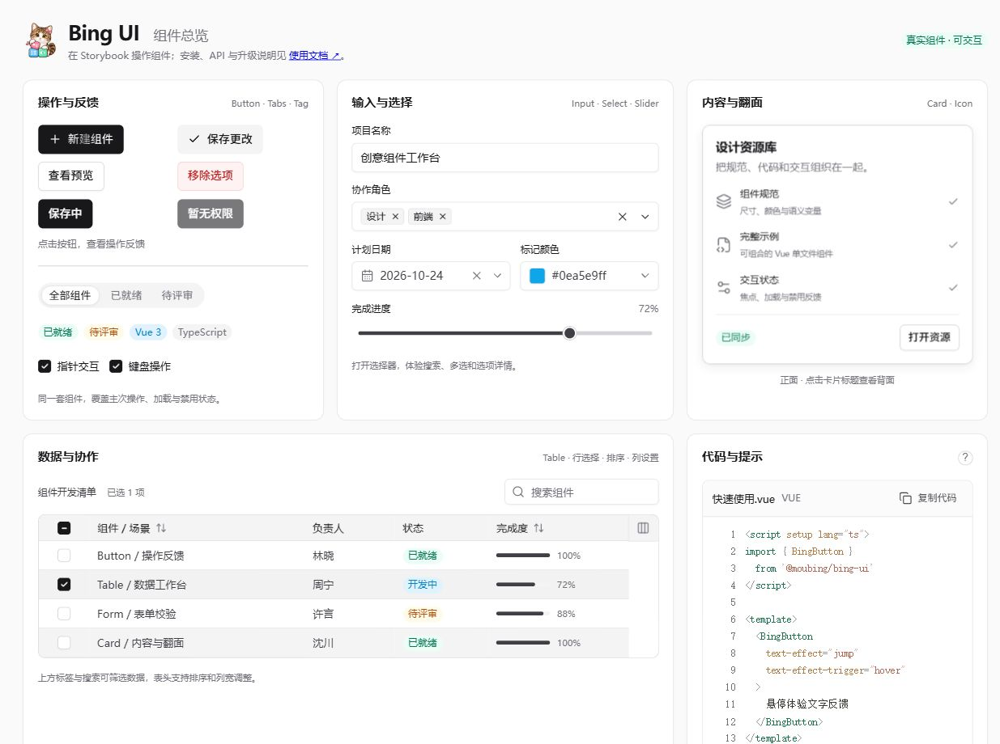
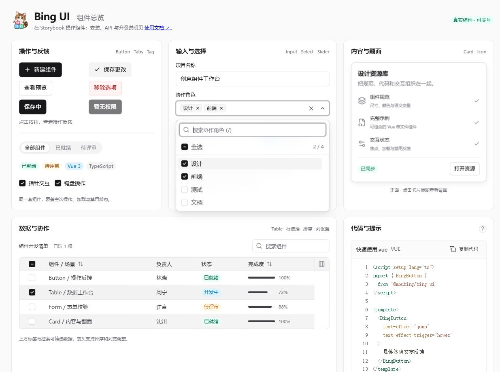
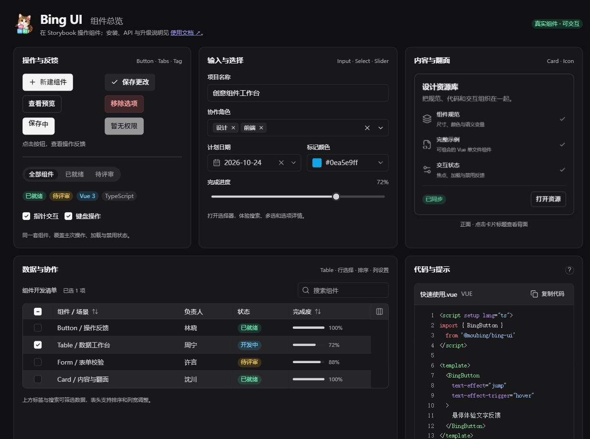

<p align="center">
  
</p>

<h1 align="center">Bing UI</h1>

<p align="center"><strong>让界面，动得恰到好处。</strong></p>
<p align="center">Vue 3 · TypeScript · GSAP · 40 个组件文档页 · 浅色 / 深色 / 跟随系统</p>
<p align="center">
  <a href="https://www.npmjs.com/package/@moubing/bing-ui"></a>
  <a href="https://www.npmjs.com/package/@moubing/bing-ui"></a>
</p>

**[在线演示 · Storybook](https://101.35.217.21:6007/?path=/docs/components-binganimatedtext--docs)** · [使用文档](https://101.35.217.21:6008/docs) · [npm 包](https://www.npmjs.com/package/@moubing/bing-ui) · [相关项目](#相关项目)

Bing UI 是一套面向创意交互和真实产品场景的 Vue 3 组件库。它以中性配色、清晰边界和轻磨砂建立安静的视觉基础，把文字反馈、卡片翻面、面板转场与平滑滚动融入日常操作，适合构建工作台、内容工具、配置面板和需要细腻反馈的应用。

组件库由我独立设计和开发，已发布到 npm，并作为 [Requirement Board](https://github.com/moubing/requirement-board) 和[文档站](https://github.com/moubing/bing-ui-docs)的界面基础在生产环境使用。

从按钮、表单到虚拟化表格、文件预览和可调整布局，组件通过显式的 Props、Emits、Slots 和 TypeScript 类型组合使用。当前仓库版本为 **0.19.0**，版本变化见 [更新日志](CHANGELOG.md)，跨版本接入见[版本升级指南](https://101.35.217.21:6008/docs/upgrade)。

[](docs/images/overview-production.jpg)

*生产 Storybook 的「Design / 组件总览 / 组件与交互」（2026-11-14）。点击图片查看原图，动效请到在线演示中体验。*

[设计与交互](#设计与交互) · [快速开始](#快速开始) · [组件一览](#组件一览) · [交互细节](#交互细节) · [主题与外观](#主题与外观) · [本地开发](#本地开发) · [进一步阅读](#进一步阅读)

## 设计与交互

### 把反馈放在操作发生的地方

- **按钮与文字**：按钮提供点击碎屑、悬停反馈和加载时的逐字跳动；`BingAnimatedText` 可单独用于文字扫光、思考中光带、字符跳动和文案逐字切换。
- **卡片与转场**：卡片支持倾斜、反光、入场与点击 / 长按翻面；应用切换、横向轮播和卡组转场分别封装为独立组件。
- **输入与滚动**：Input / Textarea 支持平滑光标；Scrollbar 提供平滑滚动和固定轨道占位，减少内容变化时的布局偏移。
- **指针反馈**：`BingCursor` 提供 16 种本地 SVG 光标状态，使用浏览器原生 CSS 光标绘制，可在局部区域或整个文档启用。

动效遵循 `prefers-reduced-motion`，并在组件卸载时清理。键盘操作、焦点反馈与禁用状态按各组件的交互方式提供；复杂组合的具体边界请查阅对应示例和说明。

### 让组件能组成实际产品

- **表单**：使用 `BingForm` / `BingFormItem` 组织响应式布局、统一尺寸和禁用状态，并通过 Zod schema 校验、定位错误和管理表单。
- **数据工作台**：表格支持树形行、行选择、分页、排序、固定列、列宽调整和虚拟滚动；可配合独立列设置、分栏和尺寸调整组件。
- **内容工具**：图片、图片预览、文件预览与代码块覆盖常见内容展示，配合菜单、弹窗、提示和消息反馈完成操作流程。
- **主题适配**：浅色、深色和系统主题共享语义变量，支持品牌色覆盖；有磨砂能力的组件可以切换为实色表面。

### 把工程细节做扎实

- **按需打包**：以纯 ESM 多文件产物发布，Vue、GSAP 和其余运行时依赖全部外置，打包器只包含实际导入的组件；Shiki 的语法与主题在首次高亮时才加载。
- **支持 SSR**：服务端渲染页面和控件本体，Teleport 浮层在客户端挂载后创建，可以直接用于 Nuxt。
- **动效可控**：动画限定在组件实例内，卸载时清理；`BingConfigProvider` 统一 JS 动效策略，默认跟随系统的减少动态效果设置。
- **测试与发版**：70 个测试文件、774 项单元与组件测试（2026-11-14 运行通过），另有 51 个无头浏览器测试文件；用 Changesets 管理版本，[更新日志](CHANGELOG.md)记录了 0.4.0 以来的每次发布。
- **在真实产品中验证**：Requirement Board 使用中发现的组件问题回到本仓库修复并发版，不在业务项目里加兼容层；组件改动要求同步更新文档站的正文、API 和示例。

## 快速开始

### 安装

在已有 Vue 3 项目中安装组件库与 GSAP：

```powershell
pnpm add @moubing/bing-ui@0.19.0 gsap@^3.15.0
```

当前包的 peer dependencies 为 `vue@^3.5.0` 和 `gsap@^3.15.0`。`zod@^4` 是可选 peer dependency：使用 `BingForm` 的 schema 校验时，请在应用中安装 Zod。

`BingFormSchema` 仅声明表单需要的 `safeParseAsync` 校验接口，可直接接收 Zod schema。未使用 Zod 校验的项目无需安装 Zod，也能正常检查组件类型。

组件库以纯 ESM 多文件形式发布，其余运行时依赖（Shiki、Day.js、dnd-kit）不再打进产物，由包管理器安装与去重；打包器只会包含实际导入的组件。`BingCodeBlock` 的 Shiki 语法与主题在首次高亮时按需加载。

### 引入样式

在应用入口全局引入一次：

```ts
// src/main.ts
import '@moubing/bing-ui/style.css'
```

### 使用组件

组件通过具名导入使用，无需全局注册。下面是一份可直接放入 `App.vue` 的示例：

```vue
<script setup lang="ts">
import { ref } from 'vue'
import { BingButton, BingCard } from '@moubing/bing-ui'

const count = ref(0)
</script>

<template>
  <main class="demo">
    <BingCard
      title="从一个交互开始"
      description="把内容、状态和操作放在一起。"
      :tilt="false"
    >
      <p role="status">你已经点击了 {{ count }} 次。</p>

      <template #footer>
        <BingButton @click="count += 1">体验交互</BingButton>
        <BingButton variant="secondary" @click="count = 0">重置</BingButton>
      </template>
    </BingCard>
  </main>
</template>

<style scoped>
.demo {
  max-width: 420px;
  margin: 64px auto;
  padding: 0 20px;
}
</style>
```

组件对应的类型也从包入口导出，例如：

```ts
import type { BingButtonProps, BingTableColumn } from '@moubing/bing-ui'
```

### 全局配置

用 `BingConfigProvider` 包住应用或局部区域，统一默认尺寸、浮层层级和动效策略。组件显式传入的 props 始终优先；嵌套的 Provider 只覆盖自己设置的字段。

```vue
<template>
  <BingConfigProvider size="sm" :z-index="4000" reduced-motion="user">
    <RouterView />
  </BingConfigProvider>
</template>
```

- **`size`**：未传 `size` 的组件使用此尺寸，优先级为组件 props → 表单 / 表单项 → 全局配置 → `md`。
- **`zIndex`**：浮层层级基准，默认 `2000`。弹窗、消息、文件 / 图片预览、颜色选择、下拉与选择面板、日期面板、提示依次在基准上加 `0 / 100 / 300 / 400 / 900 / 1000 / 1100 / 1200`。
- **`reducedMotion`**：`user`（默认）跟随系统的 `prefers-reduced-motion`，`always` 始终减少 JS 动效，`never` 忽略系统设置。CSS 中的 `@media (prefers-reduced-motion)` 规则仍只跟随系统。

自定义组件可以用 `useReducedMotion()` 获得同样的判断函数，用 `useBingConfig()` 读取当前配置。

### 在 Nuxt 中使用

在 Nuxt 配置中全局加载样式，页面中仍使用显式导入：

```ts
// nuxt.config.ts
export default defineNuxtConfig({
  css: ['@moubing/bing-ui/style.css'],
})
```

Teleport 浮层在客户端挂载后创建，服务端保留页面和控件本体。初始打开的弹层会在挂载后的更新中显示；相关测试需等待 Vue 的 `nextTick()`。业务代码若直接读取 `window` / `document`，应放在客户端生命周期中。

## 组件一览

当前文档按 **40 个组件文档页**统计，包含 ConfigProvider 和 DragDrop；DragDrop、DropDown 等页面内的子组件及工具函数不单独计数，因此此数量不等同于导出符号总数。分组如下，完整公开导出以 [组件入口](src/components/index.ts) 为准，各目录内包含实现、类型和 Storybook 示例。

| 场景 | 组件 | 主要能力 |
| --- | --- | --- |
| 基础操作与展示 | `BingButton` · `BingIcon` · `BingCard` · `BingTag` | 操作层级、图标规范、内容卡片、状态标签 |
| 文本与候选输入 | `BingInput` · `BingTextarea` · `BingAutocomplete` | 文本 / 数字输入、多行编辑、候选搜索与异步状态 |
| 选择与数值 | `BingSelect` · `BingTreeSelect` · `BingDatePicker` · `BingColorPicker` · `BingSlider` | 搜索选择、树形选择、日期时间、颜色与滑块 |
| 单选与多选 | `BingCheckbox` · `BingCheckboxGroup` · `BingRadio` · `BingRadioGroup` | 独立控件、选项组、统一状态与键盘操作 |
| 表单组织 | `BingForm` · `BingFormItem` | 布局、标签、校验、错误提示与实例方法 |
| 浮层与反馈 | `BingDialog` · `BingDropDown` · `BingTooltip` · `BingToast` | 弹窗、普通 / 右键菜单、提示与全局消息 |
| 布局与操作 | `BingTabs` · `BingScrollbar` · `BingResizable` · `BingSplitPane` · `BingSortableList` · `BingDragDrop` | 标签切换、滚动、尺寸调整、分栏、拖拽排序与跨区域拖放 |
| 全局配置 | `BingConfigProvider` | 子树默认尺寸、浮层层级基准与 JS 动效策略 |
| 数据表格 | `BingTable` · `BingTableColumnControls` | 树形行、虚拟化、服务端排序 / 分页、共享列设置 |
| 内容与预览 | `BingImage` · `BingImagePreview` · `BingFilePreview` · `BingCodeBlock` | 图片与图库、文件预览、代码高亮与复制 |
| 动效与指针 | `BingAnimatedText` · `BingAppSwitcherTransition` · `BingCarouselTransition` · `BingDeckTransition` · `BingCursor` | 文字效果、面板 / 轮播 / 卡组转场、原生光标 |

另提供 `BingDropDownItem` / `BingDropDownGroup` / `BingDropDownDivider` 菜单子组件、`BingDraggable` / `BingDropZone` / `BingDragOverlay` 拖放子组件、`bingToast` / `useBingToast` 消息服务，以及 `motion`、`prefersReducedMotion` / `useReducedMotion` 和平滑滚动相关工具。

`BingIcon` 接收本地或第三方 Vue / SVG 图标组件，负责统一尺寸、描边、颜色和可访问名称。组件库内部图标已固化为本地 SVG 组件，不需要额外安装图标库。按钮图标通过 `prefix` / `suffix` 插槽传入，可以自由选择图标来源。

### 表格与复杂交互

`BingTable` 将数据、列定义和交互状态分开管理。通过 `v-model` 可以控制选择、展开、分页、排序和列设置；`remoteSort` 与 `remotePagination` 分别用于服务端排序和分页。多个表格需要共用列偏好时，可使用 `BingTableColumnControls`。

开篇总览展示当前表格的默认斑马纹、选中行、状态标签与进度；搜索框与状态标签能联动筛选数据。完整用法见[线上 Table 文档](https://101.35.217.21:6008/docs/components/table)。

Storybook 的「Composition / 组件联动」进一步展示弹窗内表单、表格内操作控件，以及表单尺寸和禁用状态的传递。

## 交互细节

### 卡片的内容、操作与背面

`BingCard` 通过插槽容纳资源列表、图标、状态标签和操作按钮，点击或长按可以切换到背面。开篇总览右上角展示资源卡片正面，可在线点击卡片标题体验翻面。

总览示例使用默认内容、`footer` 和 `back` 插槽组织信息；卡片中的按钮保留自己的点击操作。倾斜、反光、入场和翻面效果可以在 Storybook 中实际体验。

### 多选状态与候选详情

选中的内容以可移除标签显示，展开后可以搜索、继续勾选或全选，并查看当前选择计数。下面是生产总览中“协作角色”的展开状态：

[](docs/images/select-production.jpg)

需要解释选项含义时，可配置描述和详情内容。完整行为与示例见[线上 Select 文档](https://101.35.217.21:6008/docs/components/select)。

### 颜色、透明度与预设色板

`BingColorPicker` 在同一个面板中提供二维取色、色相、透明度、预设色板、格式切换和颜色值复制。可在总览的“标记颜色”或[线上 ColorPicker 文档](https://101.35.217.21:6008/docs/components/color-picker)中展开体验。

## 主题与外观

默认浅色主题采用中性灰黑、白色表面、细边框和轻阴影；深色主题使用炭灰表面。配色、尺寸和磨砂参数集中在 [主题样式](src/theme/index.css)。

[](docs/images/overview-dark-production.jpg)

*与开篇相同的组件总览，切换为深色主题；输入状态、表格选中行、标签和代码配色一同变化。*

把主题设置在文档根元素上，让 Teleport 到 `body` 的弹层继承同一套变量：

```ts
// 在客户端执行；也可设为 'light' 或 'system'。
document.documentElement.dataset.bingTheme = 'dark'
```

`system` 会跟随操作系统外观。应用可自行保存主题偏好，并在挂载 Vue 前恢复，减少启动时的主题闪烁。局部容器上的主题不会自动传递到其 DOM 范围之外的 Teleport 浮层。

品牌定制优先覆盖语义变量，同时维护颜色值和对应的 RGB 通道：

```css
html[data-bing-theme='dark'] {
  --bing-accent-rgb: 139 92 246;
  --bing-accent-strong-rgb: 196 181 253;
  --bing-accent-solid-rgb: 167 139 250;
  --bing-accent: rgb(var(--bing-accent-rgb));
  --bing-accent-strong: rgb(var(--bing-accent-strong-rgb));
  --bing-accent-solid: rgb(var(--bing-accent-solid-rgb));
  --bing-accent-soft: rgb(var(--bing-accent-rgb) / 0.16);
  --bing-accent-contrast: #0f172a;
  --bing-focus: rgb(var(--bing-accent-rgb) / 0.62);
}
```

- **尺寸**：常规输入和选择控件的 `sm / md / lg` 高度为 `32 / 36 / 40px`；Button 另外提供 `xs=28px`、`xl=44px`。表格行高等特殊尺寸以组件 API 为准。
- **磨砂**：支持 `glass` 的组件可通过 `:glass="false"` 使用实色底；显式传入的 `glassBlur` / `glassOpacity` / `glassSaturation` 优先于主题变量。
- **代码配色**：`BingCodeBlock` 的默认 `theme="auto"` 随明暗主题切换，也可指定 Shiki 主题名。

## 本地开发

本仓库使用 pnpm；组件开发和交互验证主要在 Storybook 中进行。

```powershell
pnpm install
pnpm storybook
```

Storybook 默认使用 `6006` 端口，端口被占用时自动寻找下一个可用端口。需要临时指定起始端口时，在 PowerShell 中设置 `$env:STORYBOOK_PORT=6007` 后启动；不要追加另一组 `-p` 参数。需要独立演示入口时运行 `pnpm dev`。

### 常用命令

| 命令 | 用途 |
| --- | --- |
| `pnpm dev` | 启动 Vite 演示页面 |
| `pnpm storybook` | 启动组件示例与交互调试环境 |
| `pnpm test:run` | 运行单元 / 组件测试 |
| `pnpm test:browser` | 运行无头浏览器组件测试 |
| `pnpm build` | 类型检查并构建组件库，输出到 `dist/` |
| `pnpm build-storybook` | 生成静态 Storybook |
| `pnpm changeset` | 为需要发版的改动记录变更说明 |
| `pnpm version-packages` | 根据 Changesets 更新版本 |

按改动选择验证：逻辑改动运行单元测试，涉及公开 API 或构建的改动再执行构建，界面改动用无头 Playwright 检查受影响的 Storybook 页面；纯文档修改通常无需构建。视觉回归（`pnpm test:visual`）目前只在明确需要时运行，不随日常验证更新截图基线。

浏览器测试默认使用无头模式。内置 Chromium 不可用时，可以为本次测试临时设置 `BING_UI_BROWSER_CHANNEL=chrome` 或 `msedge`；运行后恢复环境变量，不把本机浏览器路径提交到仓库。

### 技术栈与目录

| 层次 | 实现 |
| --- | --- |
| 组件与类型 | Vue 3、TypeScript、单文件组件 |
| 动效与拖拽 | GSAP、`@dnd-kit/vue` / `@dnd-kit/dom` |
| 表单、日期与内容 | Zod、Day.js、Shiki |
| 开发与打包 | Vite 库模式、`vue-tsc`、`vite-plugin-dts` |
| 示例与验证 | Storybook、Vitest、Vue Test Utils、Playwright |
| 版本管理 | Changesets |

```text
src/
  components/              # 组件实现、类型、测试和 Storybook 示例
    BingButton/
    BingTable/
    ...
  motion/                  # 动效令牌与平滑滚动工具
  theme/                   # 全局主题与设计变量
  utils/                   # 组件间共享能力
  index.ts                 # 公开入口
.storybook/                # Storybook 配置与组合展示
tests/visual/              # 视觉回归测试
docs/                      # 接入说明、设计记录与 README 配图
.changeset/                # 版本变更记录
```

新增组件应通过组件目录的 `index.ts`、`src/components/index.ts` 和 `src/index.ts` 导出。动画需限定在实例范围内，优先使用 transform / opacity，并处理卸载清理和减少动态效果偏好。

## 进一步阅读

- [组件接入与行为说明](docs/component-notes.md)：SSR 浮层、稳定滚动条占位、数字输入、自动填充、自定义光标及旧版迁移细节。
- [更新日志](CHANGELOG.md)：已发布版本的组件与行为变化。
- [开发约定](AGENTS.md)：目录规范、动效原则和验证要求。
- [组件联动示例源码](src/components/Composition.stories.ts)：查看表单、弹窗和表格如何组合。
- [组件总览示例源码](.storybook/ReadmeShowcase.vue)：查看 README 中的组件组合，或在 Storybook「Design / 组件总览 / 组件与交互」中操作并更新配图。

## 相关项目

三个仓库构成一条完整的链路：本组件库发布到 npm，文档站说明并验证用法，Requirement Board 在真实产品中使用它。

| 项目 | 职责 | 在线入口 |
| --- | --- | --- |
| [Bing UI Docs](https://github.com/moubing/bing-ui-docs) | 快速开始、40 个组件页面、升级指南、完整示例和 AI 文档 | [使用文档](https://101.35.217.21:6008/docs) |
| [Requirement Board](https://github.com/moubing/requirement-board) | 实际使用本组件库的文档协作、版本管理与富文本 Diff 产品 | [游客体验](https://101.35.217.21/demo/) |

本文三张配图于 2026-11-14 截取自生产 Storybook，保存在 `docs/images/`。发布新版本时，本文的版本号、安装命令和文档页数由文档站的发布检查脚本核对。

公开发布范围、排除项及第三方许可说明见[公开发布说明](docs/publication.md)。
